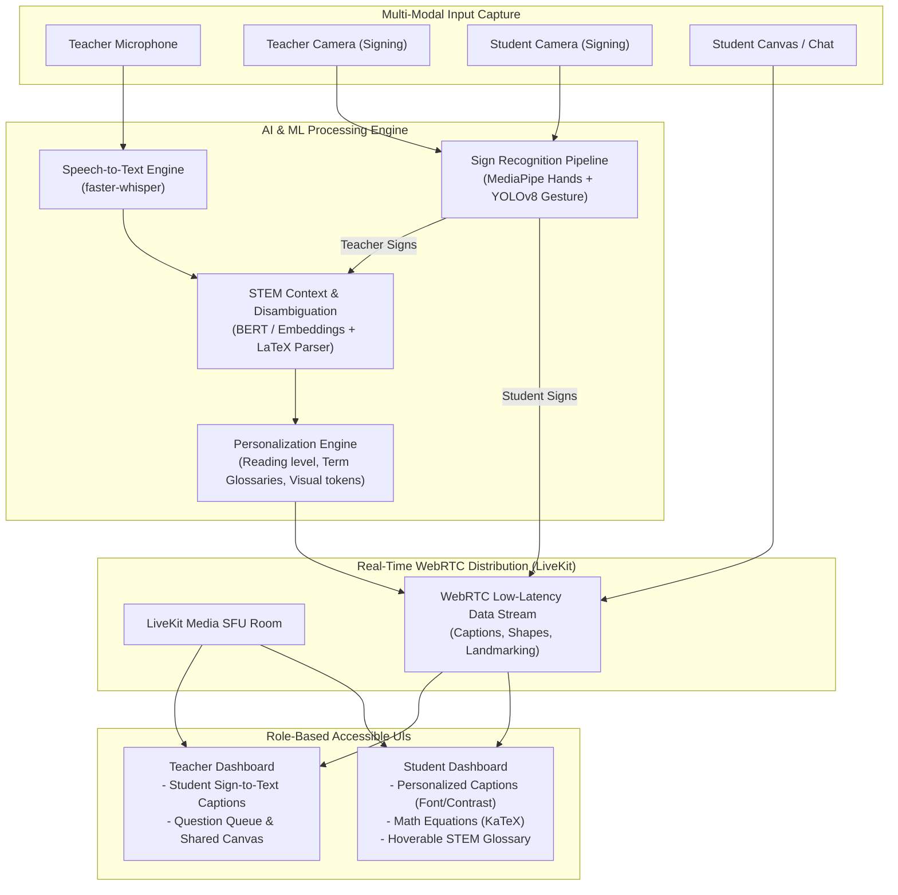

# AI-Powered Context-Aware Captioning Framework for Accessible STEM Education
## Comprehensive Implementation Plan (Version 2.0)

**Institution:** Rajalakshmi Institute of Technology, Chennai  
**Department:** Artificial Intelligence and Machine Learning  
**Project Guide:** Mr. A. Satheesh, Assistant Professor (AI & ML)  
**Team Members:** Piriyarajan P, Imanuvel K, Prasanna Venkatesh N B  

---

## 1. Executive Summary of Updated Core Requirements

Based on your project review requirements, the framework is upgraded to support **true two-way inclusivity**:

```
                       ┌──────────────────────────────────────────────┐
                       │           BIDIRECTIONAL CLASSROOM            │
                       └──────────────────────────────────────────────┘
                               ▲                              ▲
                               │                              │
         TEACHER INTERFACE     │                              │   STUDENT INTERFACE
  ┌────────────────────────────┴───────────┐      ┌───────────┴────────────────────────────┐
  │ • Spoken Speech (Whisper STT)          │      │ • Video / Audio Reception              │
  │ • Teacher Sign Language (CV -> Caption)│ ──►  │ • Multi-Level Personalized Captions    │
  │ • STEM Context-Aware NLP Engine        │      │   - Visual (Contrast, Dyslexia font)   │
  │ • Whiteboard / Screen Share            │      │   - Complexity (Basic / Advanced mode) │
  │                                        │      │   - Interactive STEM Glossary Tooltips │
  │ • Receives: Student Signs & Drawings   │ ◄──  │ • Student Response Channels:           │
  │                                        │      │   - Student Signing (CV -> Caption)    │
  │                                        │      │   - Shared Drawing & Math Canvas       │
  │                                        │      │   - Text Chat & Private Questions      │
  └────────────────────────────────────────┘      └────────────────────────────────────────┘
```

1. **Bidirectional Sign-Language-to-Caption Engine:**
   - **Teacher-Side Signing $\rightarrow$ Live Student Captions:** Allows deaf/hearing-impaired educators or bilingual signing instructors to deliver lectures in sign language, with real-time text captions generated for all students.
   - **Student-Side Signing $\rightarrow$ Live Teacher Captions:** Allows speech-impaired students to answer questions or ask for help using sign language, displayed as prominent captions in the teacher's HUD.

2. **Multi-Level Personalized Captions for Students:**
   - **Visual Personalization:** Font scale slider, high-contrast themes (Yellow on Black, Off-White Dark), line length, and Dyslexia-friendly font (OpenDyslexic).
   - **Cognitive & Complexity Personalization:** Toggle between *Literal Transcript*, *Simplified Plain English*, and *Mathematical LaTeX* representations.
   - **Interactive STEM Glossary Tooltips:** Automatic identification of scientific keywords (e.g., *Eigenvalue*, *Mitochondria*, *Derivative*) that students can hover over/click to view an instant micro-explanation and formula card.

---

## 2. Updated System Architecture



---

## 3. Detailed Module Breakdown

### Module 1: Teacher-Side & Student-Side Sign-to-Caption (Computer Vision)
Both ends share a unified, robust gesture recognition pipeline:

* **Detection Layer (MediaPipe + YOLOv8):**
  * **MediaPipe Hands:** Continuously extracts 21 3D hand landmarks $(x_i, y_i, z_i)$ per hand at 30–60 FPS.
  * **YOLOv8-Pose / YOLO-Classifier (Complementary):** Used for bounding-box detection of upper body pose and dual-hand region of interest in cluttered classroom backgrounds.
* **Temporal Sequence Modeling:**
  * Landmark coordinates are normalized relative to the wrist position:
    $$\hat{x}_i = x_i - x_0, \quad \hat{y}_i = y_i - y_0, \quad \hat{z}_i = z_i - z_0$$
  * Sequences of 30 consecutive frames ($1.0\text{ second}$) are fed into an **LSTM / GRU network** to recognize dynamic gestures.
* **Target Classroom Sign Vocabulary (25–30 signs):**
  * *Teacher Signs:* Welcome, Question, Formula, Theorem, Velocity, Force, Equal, Increase, Decrease, Understand?, Next topic.
  * *Student Signs:* Yes, No, Repeat, Don't understand, Example please, Slow down, Equal, Plus, Minus, Solution.
* **Output:** Generates a caption event sent over the LiveKit data channel (`kind: "sign_caption"`).

---

### Module 2: Context-Aware Speech Recognition & LaTeX Math Engine
* **Speech Recognition:** `faster-whisper` (`base.en` or `small.en`) running on the server.
* **STEM Disambiguation (BERT / Embeddings):**
  * Resolves acoustic ambiguities based on the active lecture subject:
    * Mathematics: *"sine"* vs. *"sign"*, *"pi"* vs. *"pie"*, *"integral"* vs. *"integer"*.
    * Physics: *"mass"* vs. *"math"*, *"newton"* vs. *"new town"*.
    * Chemistry: *"mole"* vs. *"hole"*, *"reaction"* vs. *"fraction"*.
* **Equation Auto-Formatter:** Automatically detects spoken math formulas and converts them into clean visual KaTeX notation:
  * Spoken: *"e equals m c squared"* $\rightarrow$ Formatted: $E = mc^2$
  * Spoken: *"integral of x squared d x"* $\rightarrow$ Formatted: $\int x^2 \, dx$

---

### Module 3: Deep Student Personalization Engine
Unlike generic meeting tools where everyone sees identical subtitles, the student client provides:

1. **Visual Accessibility Preferences (Stored locally in `localStorage`):**
   * **Font Scaling:** 14px to 32px with adaptive line wrapping.
   * **Color Palettes:**
     * *Default Dark:* #0f172a background, #f8fafc text.
     * *High-Contrast Yellow:* #000000 background, #facc15 text (optimal for low vision).
     * *High-Contrast White:* #000000 background, #ffffff text.
     * *Light High-Contrast:* #ffffff background, #000000 text.
   * **Typography:** Toggle between Clean Modern (`Inter`) and Dyslexia-Optimized (`OpenDyslexic`).
2. **Cognitive Complexity Modes:**
   * **Mode A (Full Verbatim):** Complete transcript with full punctuation.
   * **Mode B (STEM Focus):** Highlights keywords in bold accent color, placing formulas on dedicated lines.
   * **Mode C (Simplified Plain Text):** Condenses complex grammatical clauses into concise bullet-point statements.
3. **Interactive STEM Glossary (Hover Cards):**
   * When technical keywords appear in the caption (e.g., *Eigenvalue*, *Newton's Second Law*, *Photosynthesis*), they render as interactive pills.
   * Clicking the term opens an accessible tooltip with:
     * A one-sentence non-technical definition.
     * The standard mathematical formula or diagram thumbnail.

---

## 4. Phase-Wise Implementation Roadmap

```
PHASE 1 (Weeks 1-3) ──► PHASE 2 (Weeks 4-6) ──► PHASE 3 (Weeks 7-8) ──► PHASE 4 (Weeks 9-10)
Speech & Context NLP      Bidirectional Signing    Personalization Engine   Evaluation & Defense
```

### Phase 1: Speech & Context AI Pipeline (Backend)
- [ ] Connect `faster-whisper` streaming endpoint in FastAPI.
- [ ] Add domain context disambiguator using Sentence-Transformers / BERT.
- [ ] Implement spoken math-to-LaTeX converter with frontend KaTeX rendering.

### Phase 2: Bidirectional Sign-to-Caption Engine (Computer Vision)
- [ ] Build MediaPipe Hand landmark extractor component in React / Python.
- [ ] Record a balanced training dataset of 25 classroom signs across the project team.
- [ ] Train LSTM / Random Forest classifier and evaluate cross-validation accuracy.
- [ ] Enable sign recognition on **both** Teacher and Student interfaces.

### Phase 3: Personalized Accessible UI & Persistent DB
- [ ] Build the Student Personalization Drawer (High Contrast, Dyslexic font, Complexity switcher).
- [ ] Implement the interactive STEM Glossary popup cards.
- [ ] Connect Supabase database to persist lecture transcripts, bookmarks, and chat history.

### Phase 4: Benchmarking, Metrics & Project Report
- [ ] Run experimental evaluations on **100 STEM audio clips**:
  * Measure Word Error Rate (WER) before vs. after context processing.
  * Measure Term Accuracy Rate (TAR) on technical vocabulary.
  * Measure End-to-End Latency ($< 1.5\text{ s}$).
- [ ] Measure Sign Recognition Accuracy (Confusion Matrix, Precision/Recall).
- [ ] Finalize Project Documentation, Review PPT, and viva demonstration.

---

## 5. Metrics for Academic Evaluation (Final Review & Viva)

To present a compelling thesis defense to your external examiners, report the following quantitative metrics:

1. **Speech Accuracy:**
   $$\text{WER} = \frac{S + D + I}{N} \times 100\%$$
   Show a comparative bar chart: Baseline Web Speech (e.g. $18.4\%$) vs. Proposed Context-Aware Framework (e.g. $7.2\%$).
2. **Technical Keyword Accuracy (TAR):**
   $$\text{TAR} = \frac{\text{Correctly Recognized STEM Terms}}{\text{Total Spoken STEM Terms}} \times 100\%$$
3. **Sign Language Recognition Accuracy:**
   * Average classification accuracy across the 25 educational signs.
   * Average inference latency per frame ($\le 35\text{ ms}$ for real-time performance).
4. **Accessibility Usability Score:**
   * System Usability Scale (SUS) survey administered to test users rating readability, contrast, and two-way interaction.
